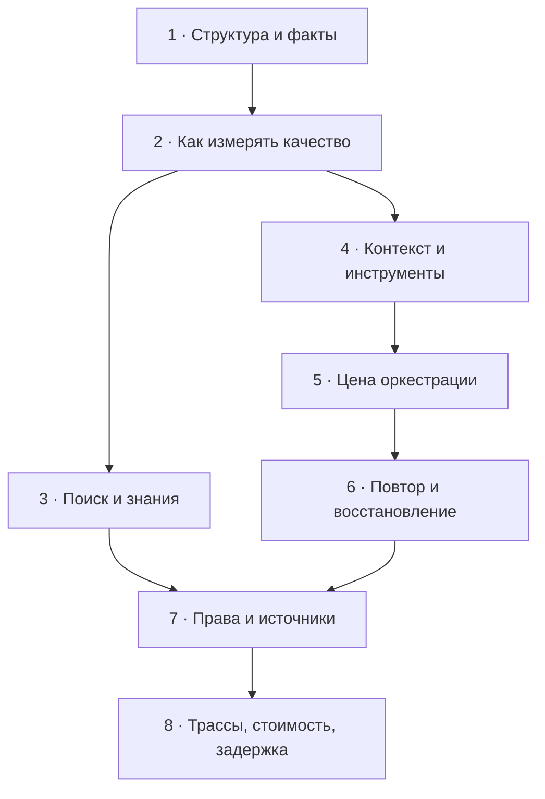

# Applied AI Engineering · карта чтения

**[Начать здесь · M42 · 10–15 минут](https://medium.com/@karthickrajam18/five-agents-talking-lost-to-five-answers-and-a-vote-d15690013740)**. После знакомства с оркестрацией прочитай *The trick hiding in most comparisons* и *One study shows the whole story*. Сначала сравни команду с одним ответом, затем с пятью независимыми ответами той же модели. Сверь также стоимость вызовов и задержку: одинаковое число ответов может обойтись командам по-разному. Следом — [M43: сравнение на tau-airline](https://medium.com/@duttasaswata7/structuring-multi-agent-systems-around-irreversible-actions-lessons-from-tau-bench-defe0f139eda).

[Коллекция Medium](https://medium.com/@jklooop/list/job-radar-llm-engineering-8-52ab9546e729) · [Каталог — 84 материала](catalog.md) · [Прочитано](read.md) · [История отбора](selection.md)

## Выбери путь

- **Frontend/Fullstack → Applied AI.** [M67](catalog.md#m67) → [M68](catalog.md#m68) → [M84](catalog.md#m84) → [M82](catalog.md#m82) → [M6](catalog.md#m6) → [M7](catalog.md#m7) → [M83](catalog.md#m83). Если обе статьи первого вечера прочитаны, на неделе 5 открывай [M46](catalog.md#m46).
- **RAG, когда основы уже знакомы.** Диагностика измерения [M23](catalog.md#m23) → гибридный поиск [M20](catalog.md#m20) → градации релевантности [M21](catalog.md#m21). Для обновляемых документов прочитай [M25](catalog.md#m25) перед M17 и [M26](catalog.md#m26) после M23.
- **Агенты после вводной серии.** [Независимые попытки M42](https://medium.com/@karthickrajam18/five-agents-talking-lost-to-five-answers-and-a-vote-d15690013740) → [запись и согласование M43](https://medium.com/@duttasaswata7/structuring-multi-agent-systems-around-irreversible-actions-lessons-from-tau-bench-defe0f139eda) → [вклад компонентов M46](catalog.md#m46) → [одинаковая спецификация и разные расходы M44](https://medium.com/@jainashish.079/single-agent-vs-multi-agent-coding-a-controlled-experiment-with-real-metrics-b8c4027e410f). [Карта агентов](agents.md).
- **Evals и эксплуатация.** [Golden set и CI M10](https://medium.com/models-to-systems/part-14-evals-knowing-whether-scout-is-any-good-0155ff1d4723) → [диагностика сбоя диалога M15](https://medium.com/@marcus.chen_88321/the-call-failed-on-turn-nine-my-eval-gave-me-one-number-for-the-whole-call-04531df3a8bc) → [привязка к trace M56](https://medium.com/@khwajakhan/llm-observability-traces-tokens-and-cost-on-a-frozen-agentic-app-e0a3b9e2c790) → [M75](catalog.md#m75) → [M76](catalog.md#m76). Для своего inference — [нагрузка M57](https://medium.com/pinterest-engineering/building-pinterests-vlm-serving-stack-on-nvidia-dynamo-0dce6e93d0f3). [Карта evals](foundation.md) · [Карта эксплуатации](production.md).

## Основная линия на восемь недель

40 основных материалов, **13 ч 07 мин** при базовом выборе. Минуты включают выборочное чтение и разбор примеров. Из бюджета 2–3 часа в неделю оставь запас на сложные разборы. Каждый ID открывает карточку с оригинальной статьёй и указаниями по чтению.

| Неделя | Читать слева направо | Что даст чтение | По интересу или вместо основного текста | Минуты |
|---|---|---|---|---:|
| [1. Основы LLM и baseline](foundation.md) | [M67](catalog.md#m67) → [M68](catalog.md#m68) → [M84](catalog.md#m84) → [M82](catalog.md#m82) → [M6](catalog.md#m6) → [M7](catalog.md#m7) → [M83](catalog.md#m83) | Выбрать baseline и модель, учесть цену ошибки, понять декодирование и отделить формат от точности. | [M8](catalog.md#m8) для reasoning-токенов; [M9](catalog.md#m9) для эффективности формата. [M62](catalog.md#m62)–[M64](catalog.md#m64) для fine-tuning. | 120 |
| [2. Оценка качества](foundation.md) | [M69](catalog.md#m69) → [M10](catalog.md#m10) → [M11](catalog.md#m11) → [M71](catalog.md#m71) → [M85](catalog.md#m85) → [M12](catalog.md#m12) | Разделить данные без утечки, измерить парную дельту и её неопределённость, проверить срезы и судью. | [M13](catalog.md#m13) вместо [M12](catalog.md#m12); [M70](catalog.md#m70) для групповой утечки; [M65](catalog.md#m65), [M14](catalog.md#m14), [M15](catalog.md#m15) по задаче. | 135 |
| [3. Поиск и базы знаний](retrieval.md) | [M72](catalog.md#m72) → [M25](catalog.md#m25) → [M17](catalog.md#m17) → [M18](catalog.md#m18) → [M20](catalog.md#m20) → [M23](catalog.md#m23) | Проследить версии, парсинг, чанкинг, retrieval и ранжирование; удаление и кеш — неделя 7. | [M80](catalog.md#m80) после [M17](catalog.md#m17); при PDF [M74](catalog.md#m74) → [M73](catalog.md#m73) после [M18](catalog.md#m18); если парсер проверен, только [M73](catalog.md#m73). [M26](catalog.md#m26) — неделя 7. | 128 |
| [4. Контекст и инструменты](agents.md) | [M32](catalog.md#m32) → [M36](catalog.md#m36) → [M37](catalog.md#m37) → [M34](catalog.md#m34) | Различить сбой модели, контракта и протокола; управлять длинной историей и потерей контекста. | [M33](catalog.md#m33) при миграции SDK; [M35](catalog.md#m35) для TypeScript MCP; [M38](catalog.md#m38)–[M40](catalog.md#m40) для кеша, траекторий и памяти. | 89 |
| [5. Агент или команда](agents.md) | [M42](catalog.md#m42) → [M43](catalog.md#m43) → [M46](catalog.md#m46) | Отделить эффект координации от бюджета попыток и проверить вклад компонентов. | Если прочитаны M42 и M43 первым вечером, начни с [M46](catalog.md#m46). [M44](catalog.md#m44) по интересу. | 63 |
| [6. Состояние и повторы](production.md) | [M48](catalog.md#m48) → [M49](catalog.md#m49) → [M81](catalog.md#m81) → [M78](catalog.md#m78) → [M79](catalog.md#m79) | Различить повтор доставки, исполнения и бизнес-эффекта; восстановить подтверждённый статус в UI. | [M50](catalog.md#m50) для replay и долгих workflow. | 78 |
| [7. Безопасность и актуальность](production.md) | [M26](catalog.md#m26) → [M52](catalog.md#m52) → [M53](catalog.md#m53) → [M86](catalog.md#m86) | Проверить удаление источника, кеш, отзыв прав и границы доверия при prompt injection. | [M54](catalog.md#m54) для approval gateway; [M66](catalog.md#m66) при семантическом кеше. | 71 |
| [8. Эксплуатация](production.md) | [M56](catalog.md#m56) → [M75](catalog.md#m75) → [M87](catalog.md#m87) → [M76](catalog.md#m76) → [M88](catalog.md#m88) | Связать трассы, офлайн-качество, цену подтверждённого результата и rollout; замкнуть feedback loop. | [M30](catalog.md#m30), [M77](catalog.md#m77) для экспериментов; [M58](catalog.md#m58) → [M57](catalog.md#m57) для своего inference; [M62](catalog.md#m62)–[M64](catalog.md#m64) для fine-tuning. | 103 |

**Границы недели 8.** M75 — офлайн-сравнение на малом наборе, M87 — учебная симуляция экономики поддержки, M76 — техническая канарейка TV UI. Реальный продуктовый успех подтверждается данными бизнес-системы. Не переносить результаты стендов на production без независимой проверки.

**Как читать метки.** «Основная» ведёт к следующему шагу, «альтернатива» заменяет указанный ID, «углубление» продолжает тему, «справочно» пригодится под конкретный вопрос. Способ чтения указан отдельно: целиком, выборочно по заголовкам или бегло по таблице или примеру.

## Дополнительные материалы

Справочные ссылки из исходного плана. К ним удобно возвращаться при чтении статей.

| Тема | Материал |
| --- | --- |
| Структурированные ответы | [OpenAI · Structured Outputs](https://platform.openai.com/docs/guides/structured-outputs) |
| Оценка качества | [Hamel Husain · AI Evals FAQ](https://hamel.dev/blog/posts/evals-faq/) |
| Выбор между workflow и агентом | [Anthropic · Building effective agents](https://www.anthropic.com/engineering/building-effective-agents) |
| Контракты инструментов | [Anthropic · Writing effective tools for AI agents](https://www.anthropic.com/engineering/writing-tools-for-agents) |
| MCP на TypeScript | [Model Context Protocol · TypeScript SDK](https://github.com/modelcontextprotocol/typescript-sdk) |
| Наблюдаемость | [OpenTelemetry · GenAI semantic conventions](https://opentelemetry.io/docs/specs/semconv/gen-ai/) |

Бесплатные курсы — следующий этап. Темы для них определятся после чтения основной подборки.
