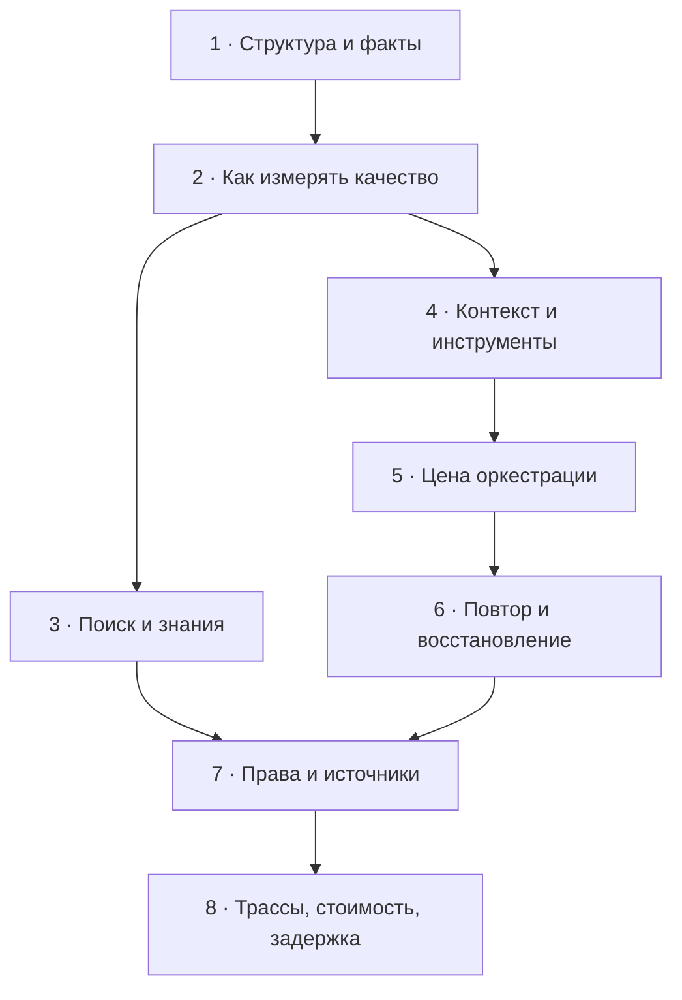

# Applied AI Engineering · карта чтения

**[Начать здесь · M42 · 10–15 минут](https://medium.com/@karthickrajam18/five-agents-talking-lost-to-five-answers-and-a-vote-d15690013740)**. После знакомства с оркестрацией прочитай *The trick hiding in most comparisons* и *One study shows the whole story*. Сначала сравни команду с одним ответом, затем с пятью независимыми ответами той же модели. Вторая точка отсчёта меняет вывод. Следом — [M43: сравнение на tau-airline](https://medium.com/@duttasaswata7/structuring-multi-agent-systems-around-irreversible-actions-lessons-from-tau-bench-defe0f139eda).

[Коллекция Medium](https://medium.com/@jklooop/list/job-radar-llm-engineering-8-52ab9546e729) · [Каталог — 60 статей](catalog.md) · [Прочитано](read.md) · [История отбора](selection.md)

## Выбери путь

- **Frontend/Fullstack → Applied AI.** Начни с [M06](https://medium.com/@yusufbender/structured-output-in-small-models-i-measured-it-the-measurement-was-broken-i-measured-again-14a4f5f27e35) и двигайся по строкам таблицы. Открытие M42 первым — быстрый способ проверить знакомую архитектуру; на неделе 5 можно сразу перейти к M43.
- **RAG, когда основы уже знакомы.** [Гибридный поиск на MS MARCO](https://medium.com/@aashiesh.siwach/i-added-hybrid-search-to-my-retrieval-pipeline-heres-why-it-backfired-5904a267fb95) → [graded nDCG на WANDS](https://medium.com/@tiagobachiegadealmeida/pragmatic-ir-benchmark-on-wands-from-tf-idf-to-hybrid-retrieval-and-cross-encoder-reranking-28d307185e71) → [диагностика ошибок метрики](https://medium.com/@ing.fernandosanabria/evaluation-first-rag-what-happened-when-my-own-metrics-lied-to-me-6810744f88ec). [Карта поиска](retrieval.md).
- **Агенты после вводной серии.** [Равный бюджет M42](https://medium.com/@karthickrajam18/five-agents-talking-lost-to-five-answers-and-a-vote-d15690013740) → [запись и согласование M43](https://medium.com/@duttasaswata7/structuring-multi-agent-systems-around-irreversible-actions-lessons-from-tau-bench-defe0f139eda) → [одинаковая спецификация и разные расходы M44](https://medium.com/@jainashish.079/single-agent-vs-multi-agent-coding-a-controlled-experiment-with-real-metrics-b8c4027e410f). [Карта агентов](agents.md).
- **Evals и эксплуатация.** [Golden set и CI M10](https://medium.com/models-to-systems/part-14-evals-knowing-whether-scout-is-any-good-0155ff1d4723) → [диагностика сбоя диалога M15](https://medium.com/@marcus.chen_88321/the-call-failed-on-turn-nine-my-eval-gave-me-one-number-for-the-whole-call-04531df3a8bc) → [привязка к trace M56](https://medium.com/@khwajakhan/llm-observability-traces-tokens-and-cost-on-a-frozen-agentic-app-e0a3b9e2c790) → [нагрузка M57](https://medium.com/pinterest-engineering/building-pinterests-vlm-serving-stack-on-nvidia-dynamo-0dce6e93d0f3). [Карта evals](foundation.md) · [Карта эксплуатации](production.md).

## Основная линия на восемь недель

20 основных статей, **8 ч 39 мин** при базовом выборе. При бюджете 2–3 часа в неделю остальное время можно отдать ветке по интересу. Выбор альтернатив M13 и M19 вместо M12 и M18 уменьшает общее время на пять минут.

| Неделя | Статьи по порядку | Минуты |
|---|---|---:|
| [1. Вывод модели](foundation.md) | [M06 · Structured output in small models: I measured it, the measurement was broken, I measured again](https://medium.com/@yusufbender/structured-output-in-small-models-i-measured-it-the-measurement-was-broken-i-measured-again-14a4f5f27e35) → [M07 · Framing beats masking: what actually moves LLM accuracy on structured outputs](https://medium.com/@mehdi.nemlaghi/framing-beats-masking-what-actually-moves-llm-accuracy-on-structured-outputs-46108dbaee1b) | 45 |
| [2. Оценка качества](foundation.md) | [M10 · Part 14: Evals — Knowing Whether Scout Is Any Good](https://medium.com/models-to-systems/part-14-evals-knowing-whether-scout-is-any-good-0155ff1d4723) → [M12 · LLMs as Judges: Measuring Bias, Hinting Effects, and Tier Preferences](https://medium.com/google-developer-experts/llms-as-judges-measuring-bias-hinting-effects-and-tier-preferences-8096a9114433) | 73 |
| [3. Поиск и базы знаний](retrieval.md) | [M17 · Building RAG from the Corpus Up, Not the Model Down](https://medium.com/@rf26/building-rag-from-the-corpus-up-not-the-model-down-ac7271325cba) → [M18 · Which RAG chunking advice survives error bars? Six rules from a held-out test](https://medium.com/@vaishnavi.sonawane.writes/which-rag-chunking-advice-survives-error-bars-six-rules-from-a-held-out-test-82b3ce2c0dfe) → [M20 · I Added Hybrid Search to My Retrieval Pipeline. It Made Things Worse.](https://medium.com/@aashiesh.siwach/i-added-hybrid-search-to-my-retrieval-pipeline-heres-why-it-backfired-5904a267fb95) → [M23 · Evaluation-first RAG: what happened when my own metrics lied to me](https://medium.com/@ing.fernandosanabria/evaluation-first-rag-what-happened-when-my-own-metrics-lied-to-me-6810744f88ec) | 95 |
| [4. Контекст и инструменты](agents.md) | [M32 · LLM System Design Series: 2/12 [Context, Contracts, and Environments]](https://medium.com/models-to-systems/llm-system-design-part-2-context-contracts-and-environments-17c546b123b3) → [M33 · I Built an Agent Loop by Hand. Then I Tried to Migrate It to the OpenAI Agents SDK](https://medium.com/@JohnMandos/i-built-an-agent-loop-by-hand-then-i-tried-to-migrate-it-to-the-openai-agents-sdk-47409209f1e1) → [M34 · Your MCP Server Works in the Inspector. Now Test it in CI](https://medium.com/@dmatoso/your-mcp-server-works-in-the-inspector-now-test-it-in-ci-d4f02bae6d75) | 81 |
| [5. Агент или команда](agents.md) | [M42 · Five agents talking lost to five answers and a vote](https://medium.com/@karthickrajam18/five-agents-talking-lost-to-five-answers-and-a-vote-d15690013740) → [M43 · Structuring multi-agent systems around irreversible actions: lessons from tau-bench](https://medium.com/@duttasaswata7/structuring-multi-agent-systems-around-irreversible-actions-lessons-from-tau-bench-defe0f139eda) | 51 |
| [6. Состояние и повторы](production.md) | [M48 · Saved to Postgres, never queued: the transactional outbox for Node](https://medium.com/@krrishkumardev/saved-to-postgres-never-queued-the-transactional-outbox-for-node-1355dbafd5d3) → [M49 · Background Jobs in Node.js with BullMQ: Retries, Idempotency and the Failure Modes](https://medium.com/@manisuec/background-jobs-in-node-js-with-bullmq-retries-idempotency-and-the-failure-modes-963b1dd24ad2) → [M50 · Deploying new Temporal workflow code while workflows are running](https://medium.com/@kalin.dimitrov93/deploying-new-temporal-workflow-code-while-workflows-are-running-a9ff9a62cfbd) | 70 |
| [7. Полномочия](production.md) | [M52 · Propagating User Identity Through an Agentic Workflow](https://medium.com/mongodb/propagating-user-identity-through-an-agentic-workflow-d19dff24e54c) → [M53 · How do you make an AI assistant respect document permissions on Databricks?](https://medium.com/@raghavmatta/how-do-you-make-an-ai-assistant-respect-document-permissions-f4a18336cc3a) | 44 |
| [8. Эксплуатация](production.md) | [M56 · LLM Observability: Traces, Tokens and Costs of Agentic App](https://medium.com/@khwajakhan/llm-observability-traces-tokens-and-cost-on-a-frozen-agentic-app-e0a3b9e2c790) → [M57 · Building Pinterest’s VLM Serving Stack on NVIDIA Dynamo](https://medium.com/pinterest-engineering/building-pinterests-vlm-serving-stack-on-nvidia-dynamo-0dce6e93d0f3) | 60 |

**Как читать метки.** «Основная» ведёт к следующему шагу, «альтернатива» заменяет указанный ID, «углубление» продолжает тему, «справочно» пригодится под конкретный вопрос. Способ чтения указан отдельно: целиком, выборочно по заголовкам или бегло по таблице или примеру.

## Дополнительные материалы

Справочные ссылки из исходного плана. К ним удобно возвращаться при чтении статей.

| Тема | Материал |
| --- | --- |
| Структурированные ответы | [OpenAI · Structured Outputs](https://platform.openai.com/docs/guides/structured-outputs) |
| Оценка качества | [Hamel Husain · AI Evals FAQ](https://hamel.dev/blog/posts/evals-faq/) |
| Выбор между workflow и агентом | [Anthropic · Building effective agents](https://www.anthropic.com/engineering/building-effective-agents) |
| Контракты инструментов | [Anthropic · Writing effective tools for AI agents](https://www.anthropic.com/engineering/writing-tools-for-agents) |
| MCP на TypeScript | [Model Context Protocol · TypeScript SDK](https://github.com/modelcontextprotocol/typescript-sdk) |
| Наблюдаемость | [OpenTelemetry · GenAI semantic conventions](https://opentelemetry.io/docs/specs/semconv/gen-ai/) |

Бесплатные курсы — следующий этап. Темы для них определятся после чтения основной подборки.
