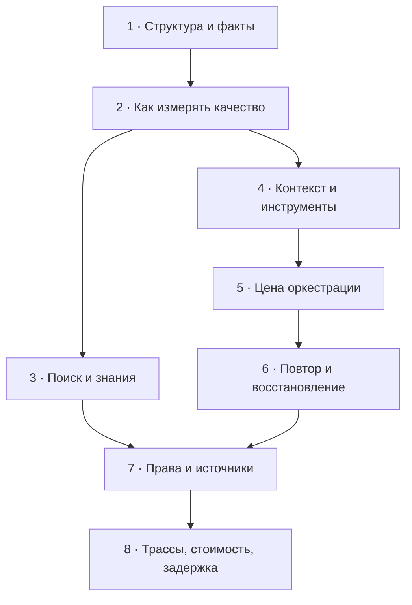

# Applied AI Engineering · карта чтения

**[Начать здесь · M42 · 10–15 минут](https://medium.com/@karthickrajam18/five-agents-talking-lost-to-five-answers-and-a-vote-d15690013740)**. После знакомства с оркестрацией прочитай *The trick hiding in most comparisons* и *One study shows the whole story*. Сначала сравни команду с одним ответом, затем с пятью независимыми ответами той же модели. Сверь также стоимость вызовов и задержку: одинаковое число ответов может обойтись командам по-разному. Следом — [M43: сравнение на tau-airline](https://medium.com/@duttasaswata7/structuring-multi-agent-systems-around-irreversible-actions-lessons-from-tau-bench-defe0f139eda).

[Коллекция Medium](https://medium.com/@jklooop/list/job-radar-llm-engineering-8-52ab9546e729) · [Каталог — 75 материалов](catalog.md) · [Прочитано](read.md) · [История отбора](selection.md)

## Выбери путь

- **Frontend/Fullstack → Applied AI.** Начни с [M67](catalog.md#m67) или [M68](catalog.md#m68) на Medium, затем переходи к [M06](https://medium.com/@yusufbender/structured-output-in-small-models-i-measured-it-the-measurement-was-broken-i-measured-again-14a4f5f27e35) и двигайся по строкам таблицы. Открытие M42 первым — быстрый способ проверить знакомую архитектуру; на неделе 5 можно сразу перейти к M43.
- **RAG, когда основы уже знакомы.** Диагностика измерения [M23](catalog.md#m23) → гибридный поиск [M20](catalog.md#m20) → градации релевантности [M21](catalog.md#m21). Для обновляемых документов прочитай [M25](catalog.md#m25) перед M17 и [M26](catalog.md#m26) после M23 (+30 мин).
- **Агенты после вводной серии.** [Независимые попытки M42](https://medium.com/@karthickrajam18/five-agents-talking-lost-to-five-answers-and-a-vote-d15690013740) → [запись и согласование M43](https://medium.com/@duttasaswata7/structuring-multi-agent-systems-around-irreversible-actions-lessons-from-tau-bench-defe0f139eda) → [вклад компонентов M46](catalog.md#m46) → [одинаковая спецификация и разные расходы M44](https://medium.com/@jainashish.079/single-agent-vs-multi-agent-coding-a-controlled-experiment-with-real-metrics-b8c4027e410f). [Карта агентов](agents.md).
- **Evals и эксплуатация.** [Golden set и CI M10](https://medium.com/models-to-systems/part-14-evals-knowing-whether-scout-is-any-good-0155ff1d4723) → [диагностика сбоя диалога M15](https://medium.com/@marcus.chen_88321/the-call-failed-on-turn-nine-my-eval-gave-me-one-number-for-the-whole-call-04531df3a8bc) → [привязка к trace M56](https://medium.com/@khwajakhan/llm-observability-traces-tokens-and-cost-on-a-frozen-agentic-app-e0a3b9e2c790) → [онлайн-эксперимент M30](catalog.md#m30). Для своего inference — [нагрузка M57](https://medium.com/pinterest-engineering/building-pinterests-vlm-serving-stack-on-nvidia-dynamo-0dce6e93d0f3). [Карта evals](foundation.md) · [Карта эксплуатации](production.md).

## Основная линия на восемь недель

26 основных материалов, **9 ч 51 мин** при базовом выборе. Минуты включают выборочное чтение и разбор примеров. Из бюджета 2–3 часа в неделю оставь запас на сложные разборы. Каждый ID открывает карточку с оригинальной статьёй и указаниями по чтению.

| Неделя | Читать слева направо | Что даст чтение | По интересу или вместо основного текста | Минуты |
|---|---|---|---|---:|
| [1. Вывод модели](foundation.md)  | [M67](catalog.md#m67) → [M06](catalog.md#m06) → [M07](catalog.md#m07) | Выбрать эвристику или классификатор для сравнения с LLM, затем отдельно проверить схему ответа и правильность значений. | Medium-вариант [M67](catalog.md#m67) — [M68](catalog.md#m68). | 55 |
| [2. Оценка качества](foundation.md)  | [M10](catalog.md#m10) → [M69](catalog.md#m69) → [M11](catalog.md#m11) → [M71](catalog.md#m71) → [M12](catalog.md#m12) | Выбрать независимую единицу проверки, увидеть провал редкого сегмента и проверить, заслуживает ли доверия оценщик. | [M70](catalog.md#m70) заменяет [M69](catalog.md#m69) для группового разбиения. Для судьи выбери [M12](catalog.md#m12) или [M13](catalog.md#m13). | 110 |
| [3. Поиск и базы знаний](retrieval.md)  | [M72](catalog.md#m72) → [M17](catalog.md#m17) → [M18](catalog.md#m18) → [M20](catalog.md#m20) → [M23](catalog.md#m23) | Локализовать промах между корпусом, представлением документа, выбором кандидатов и итоговой оценкой ответа. | PDF и таблицы — [M73](catalog.md#m73) или [M74](catalog.md#m74). Обновления и удаление — [M25](catalog.md#m25) → [M26](catalog.md#m26) → [M53](catalog.md#m53). | 110 |
| [4. Контекст и инструменты](agents.md)  | [M32](catalog.md#m32) → [M33](catalog.md#m33) → [M34](catalog.md#m34) | Разделить контракт модели, обработку ошибки агентом и тест протокола MCP. | Для длинной истории — [M36](catalog.md#m36) → [M38](catalog.md#m38). | 81 |
| [5. Агент или команда](agents.md)  | [M42](catalog.md#m42) → [M43](catalog.md#m43) | Сравнить координацию с независимыми попытками и проследить результат записи во внешней системе. | Для проверки вклада компонентов — [M46](catalog.md#m46) → [M44](catalog.md#m44). Если [M42](catalog.md#m42) уже прочитана в начале, переходи к [M43](catalog.md#m43). | 51 |
| [6. Состояние и повторы](production.md)  | [M48](catalog.md#m48) → [M49](catalog.md#m49) → [M50](catalog.md#m50) | Определить, что сохранено перед повтором, и проверить исход уже отправленного действия. | React и streaming — [M78](catalog.md#m78) → [M79](catalog.md#m79). | 70 |
| [7. Полномочия](production.md)  | [M52](catalog.md#m52) → [M53](catalog.md#m53) | Проследить, чьи права действуют при отложенном вызове и когда отозванный документ исчезает из выдачи. | Подтверждение чувствительного действия — [M54](catalog.md#m54). | 44 |
| [8. Эксплуатация](production.md)  | [M56](catalog.md#m56) → [M75](catalog.md#m75) → [M30](catalog.md#m30) | Связать трассу с качеством, расходами и задержкой, затем проверить офлайн-вывод продуктовым экспериментом. | Остановка раскатки — [M76](catalog.md#m76). Правило выбора победителя — [M77](catalog.md#m77). Для собственного inference — [M58](catalog.md#m58) → [M57](catalog.md#m57). | 70 |

**Как читать метки.** «Основная» ведёт к следующему шагу, «альтернатива» заменяет указанный ID, «углубление» продолжает тему, «справочно» пригодится под конкретный вопрос. Способ чтения указан отдельно: целиком, выборочно по заголовкам или бегло по таблице или примеру.

## Дополнительные материалы

Справочные ссылки из исходного плана. К ним удобно возвращаться при чтении статей.

| Тема | Материал |
| --- | --- |
| Структурированные ответы | [OpenAI · Structured Outputs](https://platform.openai.com/docs/guides/structured-outputs) |
| Оценка качества | [Hamel Husain · AI Evals FAQ](https://hamel.dev/blog/posts/evals-faq/) |
| Выбор между workflow и агентом | [Anthropic · Building effective agents](https://www.anthropic.com/engineering/building-effective-agents) |
| Контракты инструментов | [Anthropic · Writing effective tools for AI agents](https://www.anthropic.com/engineering/writing-tools-for-agents) |
| MCP на TypeScript | [Model Context Protocol · TypeScript SDK](https://github.com/modelcontextprotocol/typescript-sdk) |
| Наблюдаемость | [OpenTelemetry · GenAI semantic conventions](https://opentelemetry.io/docs/specs/semconv/gen-ai/) |

Бесплатные курсы — следующий этап. Темы для них определятся после чтения основной подборки.
