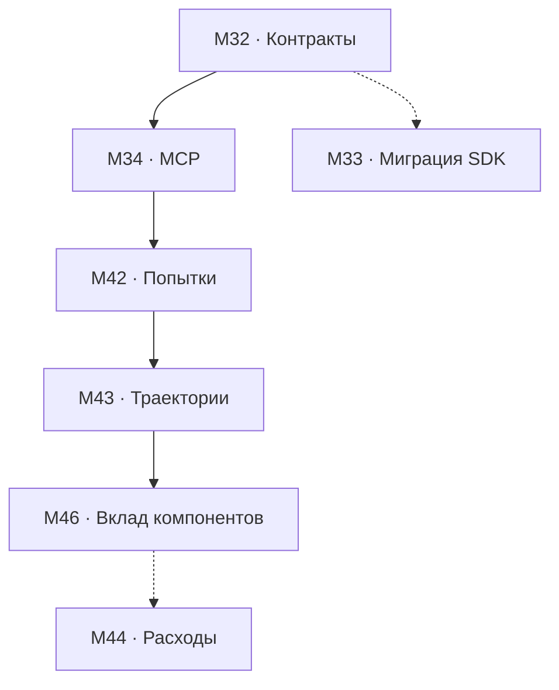

# Контекст, инструменты и оркестрация

[Обзорная карта](README.md) · [Подробные карточки](catalog.md)

## Неделя 4. Контекст и инструменты

[M32](catalog.md#m32) → [M34](catalog.md#m34)

Различить ошибку выбора инструмента, нарушение контракта и сбой протокола. [M33](catalog.md#m33) при миграции SDK. [M36](catalog.md#m36) → [M38](catalog.md#m38) для длинной истории.

### Основная линия

- [M32](catalog.md#m32) · Основная · 35 мин. [LLM System Design Series: 2/12 [Context, Contracts, and Environments]](https://medium.com/models-to-systems/llm-system-design-part-2-context-contracts-and-environments-17c546b123b3). The problem: three failures a better prompt will not fix → Idea 2: three contracts around every model call.
- [M34](catalog.md#m34) · Основная · 22 мин. [Your MCP Server Works in the Inspector. Now Test it in CI](https://medium.com/@dmatoso/your-mcp-server-works-in-the-inspector-now-test-it-in-ci-d4f02bae6d75). Connect a real client in memory → What this doesn’t test.

### По интересу

- [M33](catalog.md#m33) · Справочно · 24 мин. [I Built an Agent Loop by Hand. Then I Tried to Migrate It to the OpenAI Agents SDK](https://medium.com/@JohnMandos/i-built-an-agent-loop-by-hand-then-i-tried-to-migrate-it-to-the-openai-agents-sdk-47409209f1e1). Один набор проверок сопровождает перенос ручного цикла в SDK. Отследи, какие ошибки получает сама модель, а какие завершают вызов исключением.
- [M35](catalog.md#m35) · Справочно · 12 мин. [Build the Same MCP Server in TypeScript with the MCP SDK v2 (@modelcontextprotocol/server)](https://medium.com/@nandanpriyadarshi/build-the-same-mcp-server-in-typescript-with-the-mcp-sdk-v2-modelcontextprotocol-server-a8e4c520c965). What failed first → Limits.
- [M36](catalog.md#m36) · Углубление · 12 мин. [Are LLM’s Ignoring Half our Context — Experimentations on My Laptop](https://medium.com/@bharani3ran/are-llms-ignoring-half-our-context-experimentations-on-my-laptop-7fd6b33127ce). сравнение попаданий при перестановке факта внутри контекста.
- [M37](catalog.md#m37) · Углубление · 20 мин. [I Treated an AI Agent’s Context Window Like a Garbage-Collected Heap. Here’s What Survived.](https://medium.com/@ai.in.cz/i-treated-an-ai-agents-context-window-like-a-garbage-collected-heap-here-s-what-survived-77380afe1439). Finding 1: The stub matters more than the collector → What didn’t work.
- [M38](catalog.md#m38) · Углубление · 22 мин. [What caching does for an LLM agent ?](https://medium.com/google-cloud/what-caching-does-for-an-llm-agent-f254686e0b14). The big test: how should an agent remember? → What this does not show.
- [M39](catalog.md#m39) · Углубление · 14 мин. [Reason, Act, Observe — Then Forget: tool_trajectory, a New Context Engineering Method for AI Agents](https://michalnasternak.medium.com/reason-act-observe-then-forget-tool-trajectory-a-new-context-engineering-method-for-ai-agents-500fc28b82ab). Evaluation → Limitations.
- [M40](catalog.md#m40) · Углубление · 18 мин. [MemEval: Benchmarking Memory for AI Agents](https://medium.com/prosus-ai-tech-blog/memeval-benchmarking-memory-for-ai-agents-932d3fd9f3b4). Benchmark Results → What We Chose Not to Build.
- [M41](catalog.md#m41) · Справочно · 15 мин. [Building the Harness Around AI Coding Tools](https://medium.com/data-science-collective/a-blueprint-for-agentic-coding-tools-c1e0e2ed797b). Level 5.1: Evaluating Skills (Claude Code).

## Неделя 5. Агент или команда

[M42](catalog.md#m42) → [M43](catalog.md#m43) → [M46](catalog.md#m46)

Отделить вклад координации от бюджета попыток и проверить взаимодействие компонентов. Если первым вечером прочитаны [M42](catalog.md#m42) и [M43](catalog.md#m43), начни с [M46](catalog.md#m46). Если только [M42](catalog.md#m42), продолжи с [M43](catalog.md#m43). [M44](catalog.md#m44) по интересу.

### Основная линия

- [M42](catalog.md#m42) · Основная · 15 мин. [Five agents talking lost to five answers and a vote](https://medium.com/@karthickrajam18/five-agents-talking-lost-to-five-answers-and-a-vote-d15690013740). The trick hiding in most comparisons → One study shows the whole story.
- [M43](catalog.md#m43) · Основная · 36 мин. [Structuring multi-agent systems around irreversible actions: lessons from tau-bench](https://medium.com/@duttasaswata7/structuring-multi-agent-systems-around-irreversible-actions-lessons-from-tau-bench-defe0f139eda). На tau-airline сравниваются один агент и planner/executor с проверкой записи. Посмотри траектории и разницу между единичным успехом и повторяемостью.
- [M46](catalog.md#m46) · Основная · 12 мин. [Every Harness Component Is a Bet: How to Prove Yours Still Pays Off](https://medium.com/@sajeevkr1/every-harness-component-is-a-bet-how-to-prove-yours-still-pays-off-bcef960b2c5d). Testing a component → Components that cover for each other.

### По интересу

- [M02](catalog.md#m02) · Углубление · 20 мин. [Building Self-Improving AI Applications with Harness²: From Agent Execution to Recursive Harness Optimization](https://medium.com/@danushidk507/building-self-improving-ai-applications-with-harness%C2%B2-from-agent-execution-to-recursive-harness-9657306a8086). Eight harness components: Which should be optimized, and when?.
- [M44](catalog.md#m44) · Углубление · 8 мин. [Single Agent vs Multi-Agent Coding: A Controlled Experiment with Real Metrics](https://medium.com/@jainashish.079/single-agent-vs-multi-agent-coding-a-controlled-experiment-with-real-metrics-b8c4027e410f). Одинаковая спецификация и 18 тестов: команда потратила около 118k токенов против 41k. Сопоставь активное время с паузой из-за rate limit.
- [M45](catalog.md#m45) · Справочно · 12 мин. [Planning and Search for LLM Agents: From DAG Execution to Tree-of-Thoughts](https://medium.com/@chierhu/planning-and-search-for-llm-agents-from-dag-execution-to-tree-of-thoughts-01436d8179cd). Tree search → Reductions among architectures.
- [M47](catalog.md#m47) · Углубление · 20 мин. [From Prompt to Production: How Prompt, Context, Loop, Graph, and Harness Engineering Fit Together](https://medium.com/google-cloud/from-prompt-to-production-how-prompt-context-loop-graph-and-harness-engineering-fit-together-76c5e748a1e7). The end-to-end execution → Reliability and correctness are separate problems.
Следующая ветка — [Workflow, права и эксплуатация](production.md).
