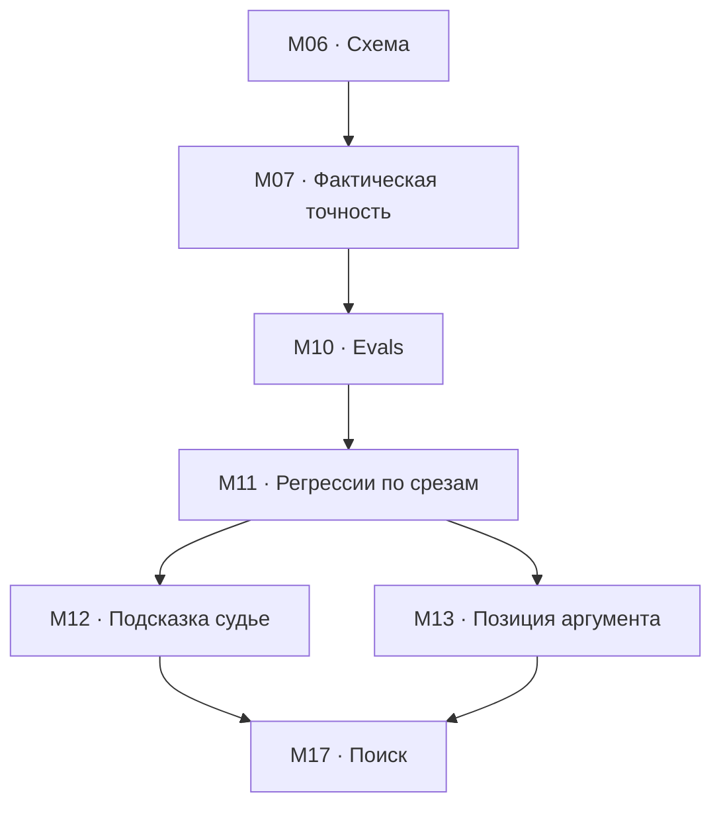

# Основы и evals

[Обзорная карта](README.md) · [Подробные карточки](catalog.md)

## Неделя 1. Вывод модели

- **[M06](catalog.md#m06) · Основная · 15 мин.** [Structured output in small models: I measured it, the measurement was broken, I measured again](https://medium.com/@yusufbender/structured-output-in-small-models-i-measured-it-the-measurement-was-broken-i-measured-again-14a4f5f27e35). Читать: What was the measurement actually measuring? → Second measurement: a strict schema.
- **[M07](catalog.md#m07) · Основная · 30 мин.** [Framing beats masking: what actually moves LLM accuracy on structured outputs](https://medium.com/@mehdi.nemlaghi/framing-beats-masking-what-actually-moves-llm-accuracy-on-structured-outputs-46108dbaee1b). Классификация одних и тех же примеров через свободный ответ, принудительную схему и tool calling разделяет эффект формата и постановки задачи.
- **[M08](catalog.md#m08) · Углубление · 12 мин.** [Your Reasoning Model Spent the Token Budget Thinking. The JSON Never Came](https://medium.com/@anhaia.gabriel/your-reasoning-model-spent-the-token-budget-thinking-the-json-never-came-9f31aead28c2). Читать: Read the envelope first.
- **[M09](catalog.md#m09) · Справочно · 12 мин.** [Token efficiency with structured output from language models](https://medium.com/data-science-at-microsoft/token-efficiency-with-structured-output-from-language-models-be2e51d3d9d5). Читать: Function calling efficiency.

## Неделя 2. Оценка качества

- **[M10](catalog.md#m10) · Основная · 48 мин.** [Part 14: Evals — Knowing Whether Scout Is Any Good](https://medium.com/models-to-systems/part-14-evals-knowing-whether-scout-is-any-good-0155ff1d4723). Сценарии с устаревшими фактами, отсутствующим ответом и плохими цитатами выявляют регрессии, которые скрывает среднее. Отдельный тест проверяет сам оценщик.
- **[M11](catalog.md#m11) · Основная · 7 мин.** [A 91% eval pass rate shipped our worst regression. We gate on the delta now.](https://medium.com/@ethan-writes-AI/a-91-eval-pass-rate-shipped-our-worst-regression-we-gate-on-the-delta-now-ef52d6613f6f). Общий pass rate прошёл порог, хотя конкретные типы запросов сломались. Сравни изменения на тех же примерах.
- **[M12](catalog.md#m12) · Основная · 25 мин.** [LLMs as Judges: Measuring Bias, Hinting Effects, and Tier Preferences](https://medium.com/google-developer-experts/llms-as-judges-measuring-bias-hinting-effects-and-tier-preferences-8096a9114433). Читать: Problem Setup → Experiment 3 : Hinting Effect.
- **[M13](catalog.md#m13) · Альтернатива M12 · 20 мин.** [Who Wins — Opening Arguments or Closing Statements? An LLM Judge’s Position Bias](https://medium.com/ai4q/who-wins-opening-arguments-or-closing-statements-an-llm-judges-position-bias-38ab7b313d63). Читать: Бегло: таблицы результатов для двух положений аргумента.
- **[M14](catalog.md#m14) · Углубление · 15 мин.** [Can LLMs Be Trusted as Annotation Judges? A Look into Document Relevance and Consistency](https://medium.com/ordina-data/can-llms-be-trusted-as-annotation-judges-a-look-into-document-relevance-and-consistency-2877975193a9). Читать: Calculating agreement → Results.
- **[M15](catalog.md#m15) · Углубление · 18 мин.** [The call failed on turn nine. My eval gave me one number for the whole call.](https://medium.com/@marcus.chen_88321/the-call-failed-on-turn-nine-my-eval-gave-me-one-number-for-the-whole-call-04531df3a8bc). Читать: The trick: score the prefixes, not the call.
- **[M16](catalog.md#m16) · Справочно · 12 мин.** [AI Skills Need CI/CD Too](https://medium.com/@aradsouza/ai-skills-need-ci-cd-too-c06be3b2c4c9). Читать: Why Compare Against a Baseline Agent?.

Следующая ветка — [Поиск и базы знаний](retrieval.md).

- **[M65](catalog.md#m65) · Углубление · 7 мин.** [An LLM judge is a biased instrument, not a measurement](https://medium.com/@maya.andersson/an-llm-judge-is-a-biased-instrument-not-a-measurement-42f0ca7d304f). Сверь оценки судьи с ручной разметкой и поменяй местами ответы в каждой паре.
