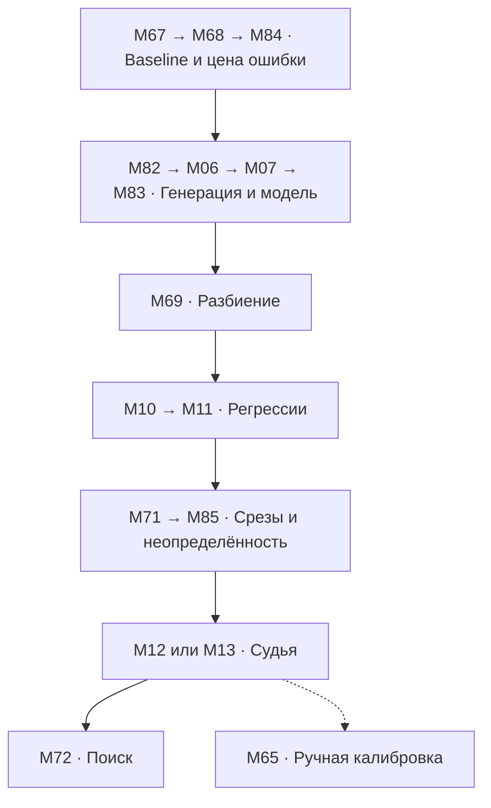

# Основы и evals

[Обзорная карта](README.md) · [Подробные карточки](catalog.md)

## Неделя 1. Вывод модели

[M67](catalog.md#m67) → [M68](catalog.md#m68) → [M84](catalog.md#m84) → [M82](catalog.md#m82) → [M6](catalog.md#m6) → [M7](catalog.md#m7) → [M83](catalog.md#m83)

Выбрать baseline и модель, учесть цену ошибки, понять декодирование и отделить формат от точности. [M8](catalog.md#m8) для reasoning-токенов; [M9](catalog.md#m9) для эффективности формата. [M62](catalog.md#m62)–[M64](catalog.md#m64) для fine-tuning.

### Основная линия

- [M67](catalog.md#m67) · Основная · 10 мин. [Rules of Machine Learning](https://developers.google.com/machine-learning/guides/rules-of-ml). Правила 1–4. Выбери простую эвристику и показатель, по которому усложнение оправдает себя. Это метод выбора baseline. Для численного примера на Medium выбери M68. Перед M68 — обязательный старт.
- [M68](catalog.md#m68) · Основная · 15 мин. [Why Using GPT May Not Be the Best Option for Customer Feedback Classification](https://medium.com/picnic-engineering/why-using-gpt-may-not-be-the-best-option-for-customer-feedback-classification-12e9c36cd4a7). Picnic сравнивает TF-IDF, DistilBERT и дообученный GPT-3 на маршрутизации отзывов. Двухдневный эксперимент 2023 года показывает дизайн сравнения. Рейтинг современных моделей требует новых измерений. [Версия команды](https://jobs.picnic.app/en/blogs/why-using-gpt-may-not-be-the-best-option-for-customer-feedback-classification). Старт недели 1. Сравни weighted Fβ с ценой редкой ошибки. Объём обучения у вариантов различался.
- [M84](catalog.md#m84) · Основная · 15 мин. [Post-tuning the decision threshold for cost-sensitive learning](https://scikit-learn.org/stable/auto_examples/model_selection/plot_cost_sensitive_learning.html). Cost-sensitive learning with constant gains and costs. Сопоставь FP/FN с потерями бизнеса, подбирай порог на validation, проверяй на held-out данных. Для вероятностного порога нужна калибровка; самооценка уверенности LLM не является калиброванной вероятностью. После M68.
- [M82](catalog.md#m82) · Основная · 20 мин. [Deep dive into Text Generation Inference with LLMs](https://huggingface.co/docs/course/chapter1/8). Prefill, Decode, Sampling Strategies. Токенизация, autoregressive decoding, logits, temperature, top-p/top-k. Logits — ненормированные оценки, а не вероятности; greedy и temperature=0 не гарантируют идентичность между версиями API. Перед M06.
- [M06](catalog.md#m06) · Основная · 15 мин. [Structured output in small models: I measured it, the measurement was broken, I measured again](https://medium.com/@yusufbender/structured-output-in-small-models-i-measured-it-the-measurement-was-broken-i-measured-again-14a4f5f27e35). What was the measurement actually measuring? → Second measurement: a strict schema.
- [M07](catalog.md#m07) · Основная · 30 мин. [Framing beats masking: what actually moves LLM accuracy on structured outputs](https://medium.com/@mehdi.nemlaghi/framing-beats-masking-what-actually-moves-llm-accuracy-on-structured-outputs-46108dbaee1b). Классификация одних и тех же примеров через свободный ответ, принудительную схему и tool calling разделяет эффект формата и постановки задачи.
- [M83](catalog.md#m83) · Основная · 15 мин. [Reasoning best practices](https://developers.openai.com/api/docs/guides/reasoning-best-practices). Разделы о выборе reasoning-моделей и сочетании моделей. Сравни обычную и reasoning-модель на одинаковых задачах с фиксированными бюджетами и измерением качества, цены, p95. Примеры поставщика не являются независимым сравнением. После M07; M08 и M75 — продолжение.

### По интересу

- [M08](catalog.md#m08) · Углубление · 12 мин. [Your Reasoning Model Spent the Token Budget Thinking. The JSON Never Came](https://medium.com/@anhaia.gabriel/your-reasoning-model-spent-the-token-budget-thinking-the-json-never-came-9f31aead28c2). Read the envelope first.
- [M09](catalog.md#m09) · Справочно · 12 мин. [Token efficiency with structured output from language models](https://medium.com/data-science-at-microsoft/token-efficiency-with-structured-output-from-language-models-be2e51d3d9d5). Function calling efficiency.

## Неделя 2. Оценка качества

[M69](catalog.md#m69) → [M10](catalog.md#m10) → [M11](catalog.md#m11) → [M71](catalog.md#m71) → [M85](catalog.md#m85) → [M12](catalog.md#m12)

Разделить данные без утечки, измерить парную дельту и её неопределённость, проверить срезы и судью. [M13](catalog.md#m13) вместо [M12](catalog.md#m12); [M70](catalog.md#m70) для групповой утечки; [M65](catalog.md#m65), [M14](catalog.md#m14), [M15](catalog.md#m15) по задаче.

### Основная линия

- [M69](catalog.md#m69) · Основная · 15 мин. [Cross-validation: evaluating estimator performance](https://scikit-learn.org/stable/modules/cross_validation.html). Прочитай подразделы про GroupKFold и TimeSeriesSplit. Выбери единицу проверки по тому, что встретится после релиза: новый документ, клиент или будущий период. Если нужны и новые группы, и будущие даты, проверь оба ограничения отдельно. Пример группового разбиения на Medium — M70. Перед M10. Заранее определи, появятся ли новые клиенты, будущие даты или оба условия сразу.
- [M10](catalog.md#m10) · Основная · 48 мин. [Part 14: Evals — Knowing Whether Scout Is Any Good](https://medium.com/models-to-systems/part-14-evals-knowing-whether-scout-is-any-good-0155ff1d4723). Сценарии с устаревшими фактами, отсутствующим ответом и плохими цитатами выявляют регрессии, которые скрывает среднее. Отдельный тест проверяет сам оценщик.
- [M11](catalog.md#m11) · Основная · 7 мин. [A 91% eval pass rate shipped our worst regression. We gate on the delta now.](https://medium.com/@ethan-writes-AI/a-91-eval-pass-rate-shipped-our-worst-regression-we-gate-on-the-delta-now-ef52d6613f6f). Общий pass rate прошёл порог, хотя конкретные типы запросов сломались. Сравни изменения на тех же примерах.
- [M71](catalog.md#m71) · Основная · 15 мин. [Heterogeneous Treatment Effects at Netflix](https://netflixtechblog.medium.com/heterogeneous-treatment-effects-at-netflix-da5c3dd58833). После M11. Discovery и Deciding Experiments. Разбери, почему число просмотренных сегментов меняет интерпретацию выброса. Масштаб онлайн-тестов Netflix ограничивает перенос на малый eval. Малый срез может выявить критический дефект. Отсутствие сигнала оставляет неопределённость.
- [M85](catalog.md#m85) · Основная · 25 мин. [Evaluation of LLM systems — статистика сравнения](https://mseyfi.github.io/llm-vlm/applications/evaluation-of-llm-systems.html). Small test sets, paired comparisons, How many items do you need? Wilson для отдельной доли, exact McNemar для парного бинарного сравнения, paired bootstrap для разницы метрик; ресэмплируй независимые группы. Заранее задай допустимую регрессию и критические дефекты; незначимый результат не доказывает эквивалентность. После M71. [Первоисточник по error bars](https://arxiv.org/abs/2411.00640).
- [M12](catalog.md#m12) · Основная · 25 мин. [LLMs as Judges: Measuring Bias, Hinting Effects, and Tier Preferences](https://medium.com/google-developer-experts/llms-as-judges-measuring-bias-hinting-effects-and-tier-preferences-8096a9114433). Problem Setup → Experiment 3 : Hinting Effect.

### По интересу

- [M13](catalog.md#m13) · Альтернатива M12 · 20 мин. [Who Wins — Opening Arguments or Closing Statements? An LLM Judge’s Position Bias](https://medium.com/ai4q/who-wins-opening-arguments-or-closing-statements-an-llm-judges-position-bias-38ab7b313d63). таблицы результатов для двух положений аргумента.
- [M14](catalog.md#m14) · Углубление · 15 мин. [Can LLMs Be Trusted as Annotation Judges? A Look into Document Relevance and Consistency](https://medium.com/ordina-data/can-llms-be-trusted-as-annotation-judges-a-look-into-document-relevance-and-consistency-2877975193a9). Calculating agreement → Results.
- [M15](catalog.md#m15) · Углубление · 18 мин. [The call failed on turn nine. My eval gave me one number for the whole call.](https://medium.com/@marcus.chen_88321/the-call-failed-on-turn-nine-my-eval-gave-me-one-number-for-the-whole-call-04531df3a8bc). The trick: score the prefixes, not the call.
- [M16](catalog.md#m16) · Справочно · 12 мин. [AI Skills Need CI/CD Too](https://medium.com/@aradsouza/ai-skills-need-ci-cd-too-c06be3b2c4c9). Why Compare Against a Baseline Agent?.
- [M65](catalog.md#m65) · Углубление · 7 мин. [An LLM judge is a biased instrument, not a measurement](https://medium.com/@maya.andersson/an-llm-judge-is-a-biased-instrument-not-a-measurement-42f0ca7d304f). Сверь оценки судьи с ручной разметкой и поменяй местами ответы в каждой паре.
- [M70](catalog.md#m70) · Углубление · 10 мин. [Your Cross-Validation Score Is a Lie, and Here Are the Five Reasons Why](https://medium.com/data-and-beyond/your-cross-validation-score-is-a-lie-and-here-are-the-five-reasons-why-b464239338d6). В разделе Leak 2 автор сравнивает случайное и групповое разбиение повторных наблюдений. Синтетические идентификаторы показывают механизм утечки. За временным разбиением вернись к M69. После M69 как пример утечки по группам.
Следующая ветка — [Поиск и базы знаний](retrieval.md).
