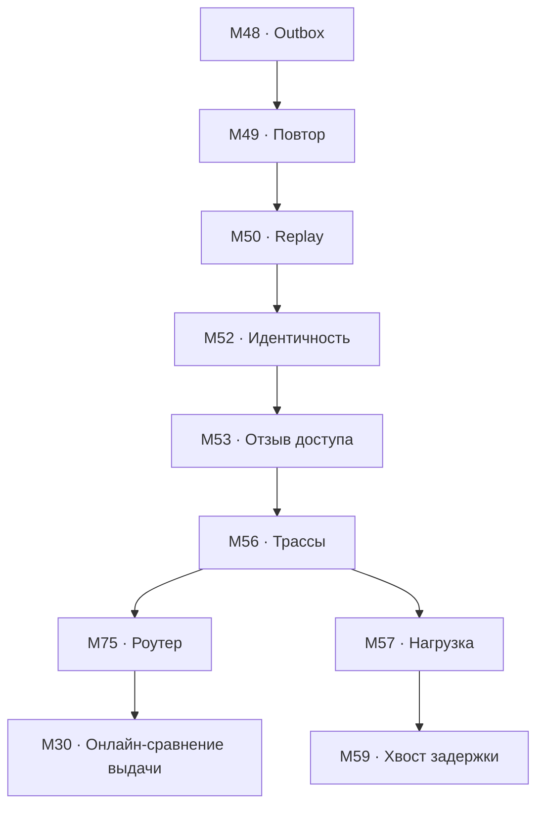

# Workflow, права и эксплуатация

[Обзорная карта](README.md) · [Подробные карточки](catalog.md)

## Неделя 6. Состояние и повторы

**Порядок:** [M48](catalog.md#m48) → [M49](catalog.md#m49) → [M50](catalog.md#m50). Определить, что сохранено перед повтором, и проверить исход уже отправленного действия. React и streaming — [M78](catalog.md#m78) → [M79](catalog.md#m79).

- [M78](catalog.md#m78) · Справочно · 5 мин. [Troubleshooting: Abort breaks resumable streams](https://ai-sdk.dev/docs/troubleshooting/abort-breaks-resumable-streams). После M49, ветка React. Разбери конфликт отмены и возобновления в useChat. Различай разрыв соединения, остановку генерации и исход внешнего действия. Ограничение относится к этому SDK. Связанный пример на Medium — M79.
- [M79](catalog.md#m79) · Справочно · 8 мин. [Why your AI response restarts on page refresh (and what it takes to prevent it)](https://medium.com/@ably_realtime/why-your-ai-response-restarts-on-page-refresh-and-what-it-takes-to-prevent-it-007789615992). После M49 вместо M78 для устройства потока или следом для сравнения. How resumable streaming actually works объясняет идентификатор ответа, позицию и повторную доставку. Пример иллюстративный, публикация поставщика. Подтверждение внешнего действия см. M49.

- **[M48](catalog.md#m48) · Основная · 18 мин.** [Saved to Postgres, never queued: the transactional outbox for Node](https://medium.com/@krrishkumardev/saved-to-postgres-never-queued-the-transactional-outbox-for-node-1355dbafd5d3). Окно между записью транзакции и постановкой задачи сохраняется при ретрае HTTP. Проследи путь одной записи outbox и её повторной доставки.
- **[M49](catalog.md#m49) · Основная · 32 мин.** [Background Jobs in Node.js with BullMQ: Retries, Idempotency and the Failure Modes](https://medium.com/@manisuec/background-jobs-in-node-js-with-bullmq-retries-idempotency-and-the-failure-modes-963b1dd24ad2). Читать: 6. Deduplication → 8. Idempotency, особенно Patterns B–D. 15. Incident playbook — справочно.
- **[M50](catalog.md#m50) · Основная · 20 мин.** [Deploying new Temporal workflow code while workflows are running](https://medium.com/@kalin.dimitrov93/deploying-new-temporal-workflow-code-while-workflows-are-running-a9ff9a62cfbd). Посмотри, как несовместимое изменение workflow ведёт себя после рестарта и при rolling deploy. История событий объясняет разницу.
- **[M51](catalog.md#m51) · Углубление · 25 мин.** [Durable Workflows at Angel One: Running Temporal as an Managed Platform](https://medium.com/angel-tech/durable-workflows-at-angel-one-running-temporal-as-an-managed-platform-d4f9acdfd9ee). Читать: Three ways to solve it → What we learned.

## Неделя 7. Полномочия

- **[M52](catalog.md#m52) · Основная · 28 мин.** [Propagating User Identity Through an Agentic Workflow](https://medium.com/mongodb/propagating-user-identity-through-an-agentic-workflow-d19dff24e54c). Сравни учётную запись агента, передачу токена пользователя и делегирование. Проследи, какую личность видит downstream-сервис при отложенном действии.
- **[M53](catalog.md#m53) · Основная · 16 мин.** [How do you make an AI assistant respect document permissions on Databricks?](https://medium.com/@raghavmatta/how-do-you-make-an-ai-assistant-respect-document-permissions-f4a18336cc3a). Читать: Does a live permission change actually flow through?.
- **[M54](catalog.md#m54) · Углубление · 12 мин.** [Building a Permission Gateway for MCP Agents:](https://medium.com/venkataprakhya7/building-a-permission-gateway-for-mcp-agents-what-i-learned-after-letting-ai-run-local-tools-b340c0c91d57). Читать: Building Approval Workflows → Open Questions.

## Неделя 8. Эксплуатация

**Порядок:** [M56](catalog.md#m56) → [M75](catalog.md#m75) → [M30](catalog.md#m30). Связать трассу с качеством, расходами и задержкой, затем проверить офлайн-вывод продуктовым экспериментом. Остановка раскатки — [M76](catalog.md#m76). Правило выбора победителя — [M77](catalog.md#m77). Для собственного inference — [M58](catalog.md#m58) → [M57](catalog.md#m57).

- [M75](catalog.md#m75) · Основа · 20 мин. [Measure LLM Cost Savings: Log Routes, Replay, Catch Drift](https://medium.com/towards-data-engineering/measure-llm-cost-savings-log-routes-replay-catch-drift-a3b15d51d1c7). После M56. The scoreboard и Drift. На 32 вопросах с тремя повторами сравни цену, качество и задержку роутера с одной моделью. Автор подбирал настройки на этих же вопросах. [Открытая версия автора](https://devsdaily.com/measure-llm-cost-savings/).
- [M76](catalog.md#m76) · Углубление · 15 мин. [Modernizing the Netflix TV UI Deployment Process](https://netflixtechblog.medium.com/modernizing-the-netflix-tv-ui-deployment-process-28e022edaaef). После M30. What about A/B-test-based canaries? Проследи решения об остановке раскатки по ошибкам JavaScript и росту памяти. Для LLM дополнительно нужен сигнал качества пользовательской задачи.
- [M77](catalog.md#m77) · Углубление · 10 мин. [Return-Aware Experimentation](https://netflixtechblog.medium.com/return-aware-experimentation-3dd93c94b67a). После M30 для углубления в эксперименты. Evaluating Decision Rules Across Many Weak Experiments. Раздели данные, на которых выбран победитель, и данные для оценки выгоды этого выбора. Метод опирается на историю экспериментов.

- **[M55](catalog.md#m55) · Справочно · 12 мин.** [OpenTelemetry for LLM Agents: Building Secure, Scalable AI Observability](https://medium.com/beyond-the-algorithm/secure-ai-observability-building-a-production-ready-opentelemetry-stack-for-llm-agents-8476031f7a3e). Читать: Designing the Trace Model for AI Agents.
- **[M56](catalog.md#m56) · Основная · 28 мин.** [LLM Observability: Traces, Tokens and Costs of Agentic App](https://medium.com/@khwajakhan/llm-observability-traces-tokens-and-cost-on-a-frozen-agentic-app-e0a3b9e2c790). Читать: Datasets & experiments — eval runs with observability context.
- **[M57](catalog.md#m57) · Углубление · 32 мин.** [Building Pinterest’s VLM Serving Stack on NVIDIA Dynamo](https://medium.com/pinterest-engineering/building-pinterests-vlm-serving-stack-on-nvidia-dynamo-0dce6e93d0f3). Читать: Benchmarking Real Multimodal Workloads with AIPerf → Lessons Learned and What’s Next.
- **[M58](catalog.md#m58) · Справочно · 15 мин.** [Inference Basics: KV Cache, Batching & Parallelism](https://medium.com/@s09g/inference-basics-kv-cache-batching-parallelism-0c04378d4067). Читать: Why KV Cache is needed → How to estimate KV Cache memory.
- **[M59](catalog.md#m59) · Углубление · 22 мин.** [Inference Routing on Kubernetes: Six Options Benchmarked](https://medium.com/todea-engineering/inference-routing-on-kubernetes-six-options-benchmarked-c9ad6ac4f3b4). Читать: How we tested → Routing configurations.
- **[M60](catalog.md#m60) · Углубление · 25 мин.** [What Really Limits LLM Inference Performance?](https://medium.com/data-science-collective/what-really-limits-llm-inference-performance-3d04ae41fe3e). Читать: What I would use in each scenario.
- **[M61](catalog.md#m61) · Углубление · 18 мин.** [›Benchmarking Semantic Caching with Oracle AI Database 26ai and Oracle True Cache](https://medium.com/oracledevs/benchmarking-semantic-caching-with-oracle-ai-database-26ai-and-oracle-true-cache-2403dd6c04d0). Читать: Decision Counts → Interpreting the Results.
- **[M62](catalog.md#m62) · Углубление · 20 мин.** [Fine-Tuning or RAG? Classifying 77 Banking Intents with a LoRA](https://medium.com/@griffinjsisk/fine-tuning-or-rag-classifying-77-banking-intents-with-a-lora-6e06591d66af). Читать: The Baseline → Cost.
- **[M63](catalog.md#m63) · Углубление · 20 мин.** [Teaching a Small Model to Check a Big Model’s Work](https://medium.com/tr-labs-ml-engineering-blog/teaching-a-small-model-to-check-a-big-models-work-a9ab7523df10). Читать: 5. Is the small model competitive?.
- **[M64](catalog.md#m64) · Углубление · 18 мин.** [Fine-tuning and serving an 11.5B SLM on one H100: how it compares with 11 Foundry models](https://medium.com/@wingnut0310/fine-tuning-and-serving-an-11-5b-slm-on-one-h100-how-it-compares-with-11-foundry-models-ac2d32c3a5e0). Читать: 4. Cost vs. Foundry → Limits.

Вернуться к [выбору специализации](README.md).

- **[M66](catalog.md#m66) · Справочно · 6 мин.** [Semantic Cache: The Math of ‘Close Enough’](https://medium.com/towards-artificial-intelligence/semantic-cache-the-math-of-close-enough-c7dda07dcdc4). Посмотри формулу свежести и ограничения кеша.
