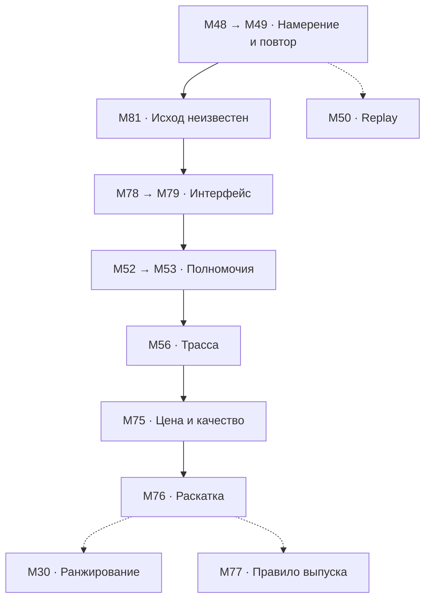

# Workflow, права и эксплуатация

[Обзорная карта](README.md) · [Подробные карточки](catalog.md)

## Неделя 6. Состояние и повторы

[M48](catalog.md#m48) → [M49](catalog.md#m49) → [M81](catalog.md#m81) → [M78](catalog.md#m78) → [M79](catalog.md#m79)

Различить повтор доставки, исполнение и бизнес-эффект. Показать пользователю подтверждённый статус при обрыве. [M50](catalog.md#m50) для replay и выкладки новой версии длительного workflow.

### Основная линия

- [M48](catalog.md#m48) · Основная · 18 мин. [Saved to Postgres, never queued: the transactional outbox for Node](https://medium.com/@krrishkumardev/saved-to-postgres-never-queued-the-transactional-outbox-for-node-1355dbafd5d3). Окно между записью транзакции и постановкой задачи сохраняется при ретрае HTTP. Проследи путь одной записи outbox и её повторной доставки.
- [M49](catalog.md#m49) · Основная · 32 мин. [Background Jobs in Node.js with BullMQ: Retries, Idempotency and the Failure Modes](https://medium.com/@manisuec/background-jobs-in-node-js-with-bullmq-retries-idempotency-and-the-failure-modes-963b1dd24ad2). 6. Deduplication → 8. Idempotency, особенно Patterns B–D. 15. Incident playbook — справочно.
- [M81](catalog.md#m81) · Основная · 15 мин. [Making agent retries safe across timeouts and restarts](https://dev.to/deavgprime/making-agent-retries-safe-across-timeouts-and-restarts-448b). После M49, перед M78. От A key did not fix the split transaction до How long does the protection last? В локальном стенде с двумя SQLite-базами автор считал созданные заказы при потерянных ответах и рестартах. Проверь, когда вместе фиксируются действие и квитанция, сколько хранится ключ и какой исход может подтвердить клиент. Близкий материал на Medium — раздел 8 в M49. Затем M78 и M79 показывают последствия для интерфейса.
- [M78](catalog.md#m78) · Основная · 5 мин. [Troubleshooting: Abort breaks resumable streams](https://ai-sdk.dev/docs/troubleshooting/abort-breaks-resumable-streams). После M81. Разбери конфликт отмены и возобновления в useChat. Различай разрыв соединения, остановку генерации и исход внешнего действия. Ограничение относится к этому SDK. Связанный пример на Medium — M79.
- [M79](catalog.md#m79) · Основная · 8 мин. [Why your AI response restarts on page refresh (and what it takes to prevent it)](https://medium.com/@ably_realtime/why-your-ai-response-restarts-on-page-refresh-and-what-it-takes-to-prevent-it-007789615992). После M78. How resumable streaming actually works объясняет идентификатор ответа, позицию и повторную доставку. Пример иллюстративный, публикация поставщика. Подтверждение внешнего действия см. M49. Сообщение об отмене внешнего действия требует подтверждения бизнес-системы. При неизвестном исходе покажи, что статус уточняется.

### По интересу

- [M50](catalog.md#m50) · Справочно · 20 мин. [Deploying new Temporal workflow code while workflows are running](https://medium.com/@kalin.dimitrov93/deploying-new-temporal-workflow-code-while-workflows-are-running-a9ff9a62cfbd). Посмотри, как несовместимое изменение workflow ведёт себя после рестарта и при rolling deploy. История событий объясняет разницу.
- [M51](catalog.md#m51) · Углубление · 25 мин. [Durable Workflows at Angel One: Running Temporal as an Managed Platform](https://medium.com/angel-tech/durable-workflows-at-angel-one-running-temporal-as-an-managed-platform-d4f9acdfd9ee). Three ways to solve it → What we learned.

## Неделя 7. Полномочия

[M52](catalog.md#m52) → [M53](catalog.md#m53)

Проверить полномочия во время исполнения и видимость документа после отзыва доступа. Вернись к [M26](catalog.md#m26) при отзыве источника. [M54](catalog.md#m54) для подтверждения действий.

### Основная линия

- [M52](catalog.md#m52) · Основная · 28 мин. [Propagating User Identity Through an Agentic Workflow](https://medium.com/mongodb/propagating-user-identity-through-an-agentic-workflow-d19dff24e54c). Сравни учётную запись агента, передачу токена пользователя и делегирование. Проследи, какую личность видит downstream-сервис при отложенном действии.
- [M53](catalog.md#m53) · Основная · 16 мин. [How do you make an AI assistant respect document permissions on Databricks?](https://medium.com/@raghavmatta/how-do-you-make-an-ai-assistant-respect-document-permissions-f4a18336cc3a). Does a live permission change actually flow through?.

### По интересу

- [M54](catalog.md#m54) · Углубление · 12 мин. [Building a Permission Gateway for MCP Agents:](https://medium.com/venkataprakhya7/building-a-permission-gateway-for-mcp-agents-what-i-learned-after-letting-ai-run-local-tools-b340c0c91d57). Building Approval Workflows → Open Questions.

## Неделя 8. Эксплуатация

[M56](catalog.md#m56) → [M75](catalog.md#m75) → [M76](catalog.md#m76)

Связать трассу с качеством, затратами и задержкой. Определить условия паузы и отката. После [M76](catalog.md#m76) выбери [M30](catalog.md#m30) для ранжирования или [M77](catalog.md#m77) для анализа правил выпуска. [M58](catalog.md#m58) → [M57](catalog.md#m57) для собственного inference.

### Основная линия

- [M56](catalog.md#m56) · Основная · 28 мин. [LLM Observability: Traces, Tokens and Costs of Agentic App](https://medium.com/@khwajakhan/llm-observability-traces-tokens-and-cost-on-a-frozen-agentic-app-e0a3b9e2c790). Datasets & experiments — eval runs with observability context.
- [M75](catalog.md#m75) · Основная · 20 мин. [Measure LLM Cost Savings: Log Routes, Replay, Catch Drift](https://medium.com/towards-data-engineering/measure-llm-cost-savings-log-routes-replay-catch-drift-a3b15d51d1c7). После M56. The scoreboard и Drift. На 32 вопросах с тремя повторами сравни цену, качество и задержку роутера с одной моделью. Автор подбирал настройки на этих же вопросах. [Открытая версия автора](https://devsdaily.com/measure-llm-cost-savings/). Для продуктовой проверки зафиксируй когорту и окно наблюдения. Раздели расходы всех попыток, включая неудачи и ручную обработку, на число подтверждённых пользовательских успехов. Отдельно покажи незавершённые задачи и повторные обращения. Офлайн-метрика $ per correct использует другой критерий успеха.
- [M76](catalog.md#m76) · Основная · 15 мин. [Modernizing the Netflix TV UI Deployment Process](https://netflixtechblog.medium.com/modernizing-the-netflix-tv-ui-deployment-process-28e022edaaef). После M75. What about A/B-test-based canaries? Проследи решения об остановке раскатки по ошибкам JavaScript и росту памяти. Для LLM дополнительно нужен сигнал качества пользовательской задачи.

### По интересу

- [M30](catalog.md#m30) · Углубление · 22 мин. [Beyond A/B Test : Speeding up Airbnb Search Ranking Experimentation through Interleaving](https://medium.com/airbnb-engineering/beyond-a-b-test-speeding-up-airbnb-search-ranking-experimentation-through-interleaving-7087afa09c8e). Team Drafting and Competitive Pairs → Alignment with A/B tests.
- [M55](catalog.md#m55) · Справочно · 12 мин. [OpenTelemetry for LLM Agents: Building Secure, Scalable AI Observability](https://medium.com/beyond-the-algorithm/secure-ai-observability-building-a-production-ready-opentelemetry-stack-for-llm-agents-8476031f7a3e). Designing the Trace Model for AI Agents.
- [M57](catalog.md#m57) · Углубление · 32 мин. [Building Pinterest’s VLM Serving Stack on NVIDIA Dynamo](https://medium.com/pinterest-engineering/building-pinterests-vlm-serving-stack-on-nvidia-dynamo-0dce6e93d0f3). Benchmarking Real Multimodal Workloads with AIPerf → Lessons Learned and What’s Next.
- [M58](catalog.md#m58) · Справочно · 15 мин. [Inference Basics: KV Cache, Batching & Parallelism](https://medium.com/@s09g/inference-basics-kv-cache-batching-parallelism-0c04378d4067). Why KV Cache is needed → How to estimate KV Cache memory.
- [M59](catalog.md#m59) · Углубление · 22 мин. [Inference Routing on Kubernetes: Six Options Benchmarked](https://medium.com/todea-engineering/inference-routing-on-kubernetes-six-options-benchmarked-c9ad6ac4f3b4). How we tested → Routing configurations.
- [M60](catalog.md#m60) · Углубление · 25 мин. [What Really Limits LLM Inference Performance?](https://medium.com/data-science-collective/what-really-limits-llm-inference-performance-3d04ae41fe3e). What I would use in each scenario.
- [M61](catalog.md#m61) · Углубление · 18 мин. [›Benchmarking Semantic Caching with Oracle AI Database 26ai and Oracle True Cache](https://medium.com/oracledevs/benchmarking-semantic-caching-with-oracle-ai-database-26ai-and-oracle-true-cache-2403dd6c04d0). Decision Counts → Interpreting the Results.
- [M62](catalog.md#m62) · Углубление · 20 мин. [Fine-Tuning or RAG? Classifying 77 Banking Intents with a LoRA](https://medium.com/@griffinjsisk/fine-tuning-or-rag-classifying-77-banking-intents-with-a-lora-6e06591d66af). The Baseline → Cost.
- [M63](catalog.md#m63) · Углубление · 20 мин. [Teaching a Small Model to Check a Big Model’s Work](https://medium.com/tr-labs-ml-engineering-blog/teaching-a-small-model-to-check-a-big-models-work-a9ab7523df10). 5. Is the small model competitive?.
- [M64](catalog.md#m64) · Углубление · 18 мин. [Fine-tuning and serving an 11.5B SLM on one H100: how it compares with 11 Foundry models](https://medium.com/@wingnut0310/fine-tuning-and-serving-an-11-5b-slm-on-one-h100-how-it-compares-with-11-foundry-models-ac2d32c3a5e0). 4. Cost vs. Foundry → Limits.
- [M66](catalog.md#m66) · Справочно · 6 мин. [Semantic Cache: The Math of ‘Close Enough’](https://medium.com/towards-artificial-intelligence/semantic-cache-the-math-of-close-enough-c7dda07dcdc4). Посмотри формулу свежести и ограничения кеша.
- [M77](catalog.md#m77) · Углубление · 10 мин. [Return-Aware Experimentation](https://netflixtechblog.medium.com/return-aware-experimentation-3dd93c94b67a). После M76 для углубления в эксперименты. Evaluating Decision Rules Across Many Weak Experiments. Раздели данные, на которых выбран победитель, и данные для оценки выгоды этого выбора. Метод опирается на историю экспериментов.
Вернуться к [выбору специализации](README.md).
