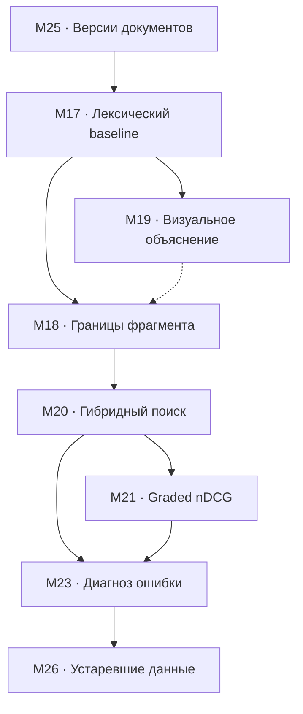

# Поиск и базы знаний

[Обзорная карта](README.md) · [Подробные карточки](catalog.md)

## Неделя 3. Поиск и базы знаний

- **[M17](catalog.md#m17) · Основная · 32 мин.** [Building RAG from the Corpus Up, Not the Model Down](https://medium.com/@rf26/building-rag-from-the-corpus-up-not-the-model-down-ac7271325cba). Сопоставь BM25, dense и RRF. Обрезание входа энкодером изменило состав индекса ещё до этапа ранжирования.
- **[M18](catalog.md#m18) · Основная · 18 мин.** [Which RAG chunking advice survives error bars? Six rules from a held-out test](https://medium.com/@vaishnavi.sonawane.writes/which-rag-chunking-advice-survives-error-bars-six-rules-from-a-held-out-test-82b3ce2c0dfe). Автор разделяет настройку и отложенную проверку. Для промахов различает чужой документ и неподходящий фрагмент правильного документа.
- **[M19](catalog.md#m19) · Углубление · 18 мин.** [There’s no Winning Chunking Strategy, Just a Corpus You Haven’t Measured](https://paradigma-digital.medium.com/theres-no-winning-chunking-strategy-just-a-corpus-you-haven-t-measured-a44512467ce2). Читать: Fixed windows: a surprisingly robust strategy.
- **[M20](catalog.md#m20) · Основная · 20 мин.** [I Added Hybrid Search to My Retrieval Pipeline. It Made Things Worse.](https://medium.com/@aashiesh.siwach/i-added-hybrid-search-to-my-retrieval-pipeline-heres-why-it-backfired-5904a267fb95). На подмножестве MS MARCO добавление BM25 к dense понизило MAP@5; последующий reranker изменил вывод. Проследи вклад каждого этапа.
- **[M21](catalog.md#m21) · Углубление · 24 мин.** [Pragmatic IR Benchmark on WANDS: From TF-IDF to Hybrid Retrieval and Cross-Encoder Reranking](https://medium.com/@tiagobachiegadealmeida/pragmatic-ir-benchmark-on-wands-from-tf-idf-to-hybrid-retrieval-and-cross-encoder-reranking-28d307185e71). Читать: Limitations and next tests; таблица MAP@10 и NDCG@10.
- **[M22](catalog.md#m22) · Углубление · 20 мин.** [RAG evaluation with Ragas](https://medium.com/data-science-lab-amsterdam/rag-evaluation-with-ragas-3a0cd1e34909). Читать: Evaluating the RAG model → Key findings.
- **[M23](catalog.md#m23) · Основная · 25 мин.** [Evaluation-first RAG: what happened when my own metrics lied to me](https://medium.com/@ing.fernandosanabria/evaluation-first-rag-what-happened-when-my-own-metrics-lied-to-me-6810744f88ec). Читать: Read-only rank probes → When the measurement apparatus lied.
- **[M24](catalog.md#m24) · Углубление · 22 мин.** [Lessons From Building a RAG System That Admits When It Doesn’t Know](https://medium.com/@anirudhece2020/lessons-from-building-a-rag-system-that-admits-when-it-doesnt-know-71930a117c2b). Читать: Decisions, costs, and when I would revisit them.
- **[M25](catalog.md#m25) · Углубление · 18 мин.** [Building the Ingestion Pipeline for a RAG System](https://medium.com/@mrcrdg/building-the-ingestion-pipeline-for-a-rag-system-c0f7fc0a3859). Читать: Incremental loads and idempotency → Comparing the two versions.
- **[M26](catalog.md#m26) · Справочно · 12 мин.** [How to Detect RAG Index Drift: Deleted Docs, Stale Chunks, and Duplicate Embeddings](https://medium.com/oracledevs/how-to-detect-rag-index-drift-deleted-docs-stale-chunks-and-duplicate-embeddings-5b5a21cc9244). Читать: Which regression test catches the most important failure?.
- **[M27](catalog.md#m27) · Углубление · 25 мин.** [Evolving Pinterest’s Embedding Retrieval Platform](https://medium.com/pinterest-engineering/evolving-pinterests-embedding-retrieval-platform-aede4e831e01). Читать: Quantization: Redefining the Footprint of High-Recall Search.
- **[M28](catalog.md#m28) · Углубление · 22 мин.** [Embedding-based retrieval for Airbnb search](https://medium.com/airbnb-engineering/embedding-based-retrieval-for-airbnb-search-aabebfc85839). Читать: Training data construction → Online serving.
- **[M29](catalog.md#m29) · Справочно · 12 мин.** [Hybrid Search: Building a textual and visual discovery experience at Pinterest](https://medium.com/pinterest-engineering/hybrid-search-building-a-textual-and-visual-discovery-experience-at-pinterest-8527ba9728a9). Читать: Бегло: пример уточнения поиска изображением и сравнение вовлечённости.
- **[M30](catalog.md#m30) · Основная · 22 мин.** [Beyond A/B Test : Speeding up Airbnb Search Ranking Experimentation through Interleaving](https://medium.com/airbnb-engineering/beyond-a-b-test-speeding-up-airbnb-search-ranking-experimentation-through-interleaving-7087afa09c8e). Читать: Team Drafting and Competitive Pairs → Alignment with A/B tests.
- **[M31](catalog.md#m31) · Справочно · 15 мин.** [Beyond Traditional Vector DBs: An Empirical Benchmark of In-Warehouse using native Google BigQuery, Local CPU, and Just-In-Time RAG methods](https://medium.com/google-cloud/beyond-traditional-vector-dbs-an-empirical-benchmark-of-in-warehouse-local-cpu-and-just-in-time-e9d14ed5a64a). Читать: The Break-Even Analysis: Economic Crossover Points.

Следующая ветка — [Контекст, инструменты и оркестрация](agents.md).
